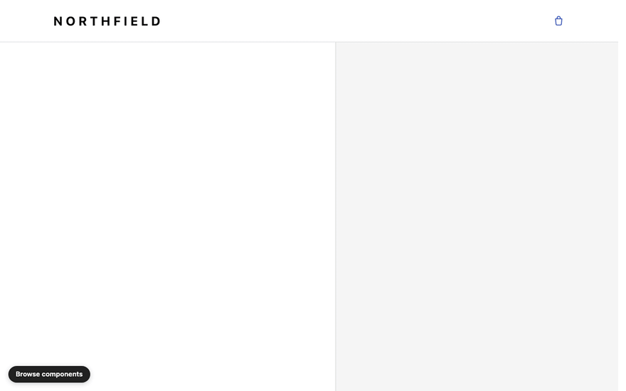
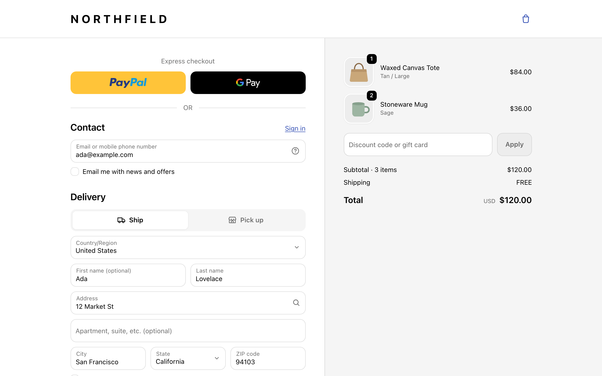
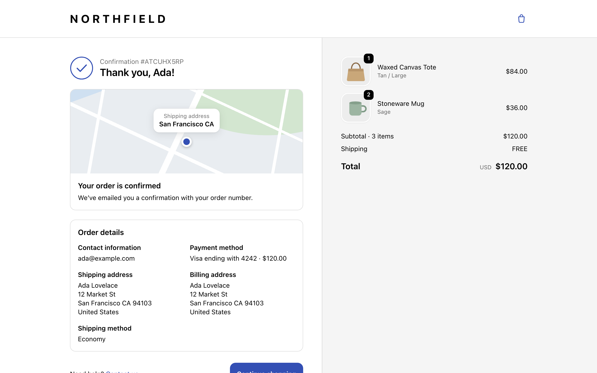
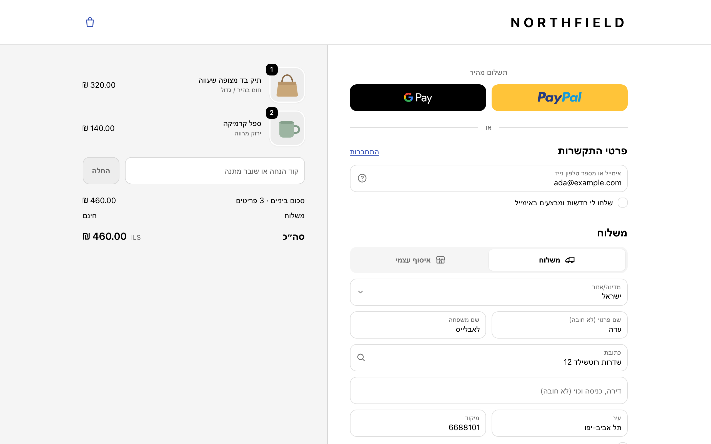
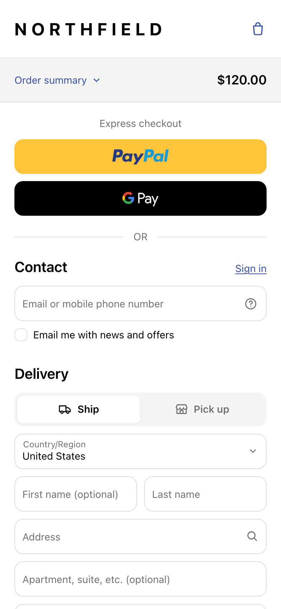

# React Shopify-style checkout

A one-page checkout for React, modelled on Shopify's. Take the whole page, one block of it, or a single input. No UI dependencies.

**[Live demo](https://gurfi1.github.io/react-shopify-style-checkout/)** · **[Component gallery](https://gurfi1.github.io/react-shopify-style-checkout/#/components)** · **[Docs](docs/getting-started.md)**

> An independent open-source project. It is not affiliated with, endorsed by or connected to Shopify. See [NOTICE.md](NOTICE.md).



| Checkout | Thank-you page | Right to left, in Hebrew | On a phone |
|---|---|---|---|
|  |  |  |  |

## What you get

- **The whole checkout.** One component, `<Checkout>`: contact, delivery, payment, order summary, and the thank-you page it turns into.
- **18 checkout blocks** that work without the rest: address form, shipping methods, payment methods, order summary, the page-load skeleton and more.
- **23 building blocks** that work anywhere: floating-label fields, choice lists, a segmented control, modal, tooltip, combobox and more.
- **The logic with no interface:** a `useCheckout` hook and plain functions for card formatting, address rules and validation, for when you want the behaviour under your own design.

Each component is one folder with its own stylesheet, a live demo and a README. The only runtime dependencies are `react` and `react-dom`.

## Try it

```bash
git clone https://github.com/gurfi1/react-shopify-style-checkout.git
cd react-shopify-style-checkout
npm install
npm run dev
```

Everything runs in your browser on canned data; nothing is sent anywhere. Discount code `WELCOME10` works, and a card number ending in `0002` is declined.

## Use the whole checkout

Copy the `src/` folder into your app (here as `checkout-kit`), then:

```tsx
import { Checkout, type CheckoutApi, type LineItemData } from './checkout-kit';

const api: CheckoutApi = {
  suggestAddresses: async (query, country) => [],
  shippingRates: async address => [{ id: 'standard', name: 'Standard', eta: '3 to 4 business days', price: 6.9 }],
  applyDiscount: async code => { throw new Error('Enter a valid discount code'); },
  placeOrder: async order => ({ confirmation: 'K7RM2XQ4P' }),
};

export function CheckoutPage({ cart }: { cart: { lines: LineItemData[] } }) {
  return <Checkout api={api} items={cart.lines} storeName="Northfield" accent="#334fb4" currency="USD" />;
}
```

Replace the four functions with calls to your server. [docs/getting-started.md](docs/getting-started.md) walks through it.

## Use one piece

Every component needs a `Theme` above it. That is the only setup.

```tsx
import { useState } from 'react';
import { TextField, Theme } from './checkout-kit';

export function EmailField() {
  const [email, setEmail] = useState('');
  return (
    <Theme>
      <TextField label="Email" value={email} onChange={event => setEmail(event.target.value)} />
    </Theme>
  );
}
```

A larger block works the same way:

```tsx
import { useState } from 'react';
import { AddressForm, emptyAddress, Theme } from './checkout-kit';

export function ShippingAddress() {
  const [address, setAddress] = useState(() => emptyAddress('US'));
  return (
    <Theme>
      <AddressForm value={address} onChange={next => setAddress(next)} />
    </Theme>
  );
}
```

Class names are scoped per component and `Theme` styles only what is inside it, so a single component is safe on a page that already uses Tailwind, Bootstrap or your own CSS. Each component's README lists exactly which folders to copy.

## Connect your back end

The checkout calls four functions that you supply. All four are required, so it will not compile with one missing.

| Call | Runs when | You return |
|---|---|---|
| `suggestAddresses(query, country)` | Three characters are typed in the address line | Up to five addresses, or `[]` |
| `shippingRates(address)` | The address is complete | Rates to choose from, or `[]` if you cannot ship there |
| `applyDiscount(code)` | Apply is pressed | The code and the amount off, or throw an error whose message is shown |
| `placeOrder(order)` | Pay is pressed and the form is valid | A confirmation code, or throw if the payment fails |

Loading states, races between slow answers, and "Pay pressed before rates arrived" are already handled. Full shapes are in [docs/backend.md](docs/backend.md).

## Make it yours

```tsx
<Checkout
  accent="#0a7c59"                        // one colour re-themes buttons, links, focus and selection
  locale="de-DE" currency="EUR"           // prices formatted by the browser
  labels={{ payNow: 'Jetzt bezahlen' }}   // replace any wording; the rest stays English
  …
/>
```

- [docs/theming.md](docs/theming.md): every token for colour, corners, shadows and timing.
- [docs/wording-and-locale.md](docs/wording-and-locale.md): translating, currencies, per-country address wording, and right-to-left languages.

Right to left works out of the box, and Hebrew wording is included:

```tsx
import { Checkout, he } from './checkout-kit';

<Checkout dir="rtl" labels={he} locale="he-IL" currency="ILS" … />
```

## Components

Each name links to a folder with the component, its README and its demo.

<!-- components:start -->
### Building blocks

| Component | What it is |
|---|---|
| [Heading, Text, Link](src/primitives/Text) | The type scale and the accent link. |
| [TextField](src/primitives/TextField) | A 49px text input with a floating label. |
| [SelectField](src/primitives/SelectField) | A native select dressed as a text field. |
| [FieldError](src/primitives/FieldError) | The message that opens under a field. |
| [Checkbox](src/primitives/Checkbox) | A native checkbox under an 18px drawn box. |
| [Radio](src/primitives/Radio) | The bare radio used inside `ChoiceList`. |
| [ChoiceList](src/primitives/ChoiceList) | Radio rows joined into one rounded box, used for shipping rates, pickup locations and payment methods. |
| [SegmentedControl](src/primitives/SegmentedControl) | A switch between a few options. |
| [Button](src/primitives/Button) | Two styles, both from the checkout: the 50px primary button, and the quiet apply button that stays grey until it has something to do. |
| [Spinner](src/primitives/Spinner) | A 2px round-capped arc on a 1.6s loop. |
| [Tooltip, InfoButton](src/primitives/Tooltip) | A near-black bubble with white 12px text, up to 190px wide, with a small arrow. |
| [Combobox](src/primitives/Combobox) | A text field with an async suggestion list. |
| [Collapsible](src/primitives/Collapsible) | Opens and closes content over 200ms by animating a grid row from 0fr to 1fr, so nothing is measured in JavaScript. |
| [ContentSwap](src/primitives/ContentSwap) | Swaps content in place. |
| [Reveal](src/primitives/Reveal) | Content that rises 10px and fades in over 400ms. |
| [Skeleton](src/primitives/Skeleton) | A grey placeholder with 6px corners that pulses to half opacity on a 1.35s loop. |
| [Banner](src/primitives/Banner) | The critical message shown when a payment fails. |
| [Tag](src/primitives/Tag) | A grey chip with a price-tag icon, used for an applied discount code. |
| [Divider](src/primitives/Divider) | A 1px line in the border colour, optionally with grey text centred on it. |
| [Modal](src/primitives/Modal) | A dialog up to 600px wide over a 60% black backdrop. |
| [Card](src/primitives/Card) | The bordered container the thank-you page is built from: 1px border, 12px corners, 16px padding in the body. |
| [Thumbnail](src/primitives/Thumbnail) | A 64px frame for a product image: 16px corners, 2px white border, hairline shadow. |
| [Stack, FieldGrid](src/primitives/Layout) | The form’s spacing. |

### Checkout blocks

| Component | What it is |
|---|---|
| [CheckoutLayout, CheckoutHeader](src/checkout/CheckoutLayout) | The page shell. |
| [CheckoutSkeleton, OrderSummarySkeleton](src/checkout/CheckoutSkeleton) | What the page shows while it loads. |
| [ExpressCheckout](src/checkout/ExpressCheckout) | A row of wallet buttons above the form with an “OR” line under it. |
| [ContactField](src/checkout/ContactField) | One field for an email or a mobile number. |
| [AddressForm](src/checkout/AddressForm) | Address fields that follow the country. |
| [AddressAutocomplete](src/checkout/AddressAutocomplete) | The address line with lookup. |
| [ShippingMethods](src/checkout/ShippingMethods) | The shipping method block in its four states: a grey box asking for the address, a skeleton while rates load, a grey box when the address cannot be shipped to, and the list of rates. |
| [PickupLocations](src/checkout/PickupLocations) | What the Delivery section shows for Pick up: a heading, how many stores have stock, and a choice list with each store’s address, readiness and distance. |
| [PaymentMethods](src/checkout/PaymentMethods) | Payment methods as a choice list with panels. |
| [CardFields, CardBrandBadges](src/checkout/CardFields) | Card number, expiry, security code and name, formatted as typed: groups of four (4-6-5 for American Express), `MM / YY` with a leading zero added, digits only. |
| [OrderSummary, OrderSummaryToggle](src/checkout/OrderSummary) | The grey column’s content: products, the discount field and the totals. |
| [LineItem, Totals, DiscountField](src/checkout/OrderSummary) | The order summary’s three parts, each usable alone. |
| [PolicyLinks](src/checkout/PolicyLinks) | The footer’s row of links. |
| [ConfirmationCheck](src/checkout/ConfirmationCheck) | The order-confirmed icon. |
| [ConfirmationCode](src/checkout/ConfirmationCode) | Text whose characters appear one at a time, 13ms apart, each rising half a line and settling with a slight overshoot. |
| [MapCard](src/checkout/MapCard) | A 180px stylised map for the top of the confirmation card. |
| [OrderDetails, ThankYou](src/checkout/ThankYou) | `ThankYou` is the confirmation page: tick, code and heading, the map card, the order details and a way onward, rising in 90ms apart. |
| [Checkout](src/checkout/Checkout) | Everything assembled into the page: layout, form, order summary, and the thank-you page it turns into. |
<!-- components:end -->

Hooks and helpers: [`src/hooks`](src/hooks) · [`src/lib`](src/lib) · [`src/icons`](src/icons) · [`src/theme`](src/theme) · [`src/locales`](src/locales)

## What it is not

- **Not a payment integration.** The card inputs are placeholders. A real site swaps them for its payment provider's hosted fields. [docs/payments.md](docs/payments.md) explains how and why.
- **Not a cart or a back end.** It does not know your products, stock, tax or shipping prices. Your server does.
- **Not an npm package yet.** You copy the source. That may change once the props have settled.
- **Not a Shopify product**, and it does not connect to Shopify.

## Browser support and accessibility

| | Status |
|---|---|
| Chromium (Chrome, Edge, Brave) | Tested throughout development |
| iOS Safari | One full pass on iOS 26.2 in the Simulator: an order placed start to finish |
| Firefox, desktop Safari, Android | **Not tested.** The CSS needs `color-mix()` and container queries, so roughly Chrome 111, Safari 16.2 and Firefox 113 or newer |
| Automated accessibility scan | axe-core reports no violations on any of five checkout states |
| Keyboard only | An order can be placed without a mouse |
| Reduced motion | Honoured; all motion drops to 1ms |
| Screen readers | **Not tested**, though roles and names are in place |
| Right-to-left | Tested with Hebrew in Chromium. The demo has a [Hebrew mode](https://gurfi1.github.io/react-shopify-style-checkout/?lang=he). Arabic is **not tested** |

Details, and four known gaps, are in [docs/accessibility.md](docs/accessibility.md).

## Where the design comes from

The layout, measurements and timings are modelled on Shopify's one-page checkout as it appeared on a public demo store in late 2026. The code, the wording and the interface icons were written for this project. [docs/design-spec.md](docs/design-spec.md) lists every measurement and says which were measured, which were interpreted, and which are this project's own additions.

## Contributing

Issues and pull requests are welcome, from anyone. Good places to start:

- Try it in Firefox, desktop Safari, with a screen reader, or in Arabic, and report what you find.
- Translate the labels into your language. Hebrew is in [`src/locales`](src/locales) as the model.
- Fix one of the [known accessibility gaps](docs/accessibility.md#known-gaps).
- Add component tests. The logic is tested; the components were checked by hand.
- Add a country's address format.

[CONTRIBUTING.md](CONTRIBUTING.md) explains how the project is laid out and what a pull request needs.

## Licence and notices

[MIT](LICENSE). The card and wallet logos are trademarks of their owners and come with their own terms; see [NOTICE.md](NOTICE.md).
